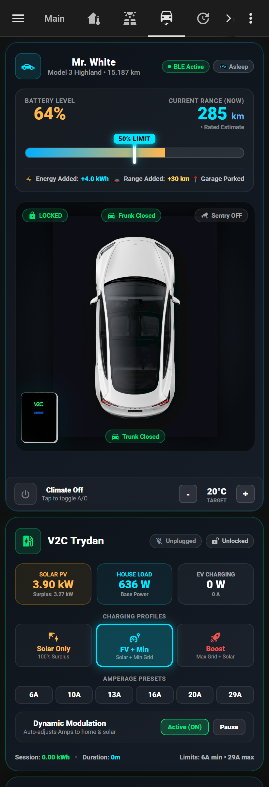
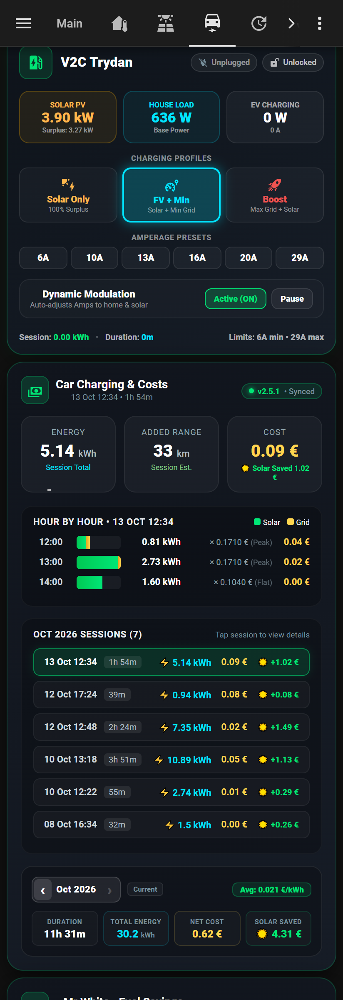
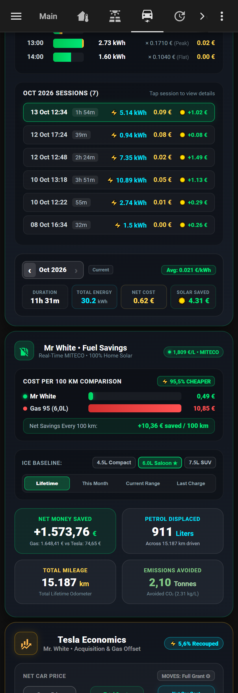
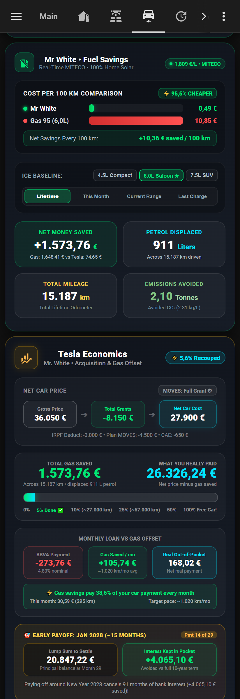

# ⚡ Tesla & V2C Mission Control — Home Assistant Dashboard

An ultra-modern, interactive Tesla and EV Home Charging Mission Control dashboard for **Home Assistant**, featuring a 2D top-down cockpit, real-time vehicle BLE telemetry, liquid charging animations, smart V2C Trydan dynamic EVSE modulation, Spanish Government MITECO fuel economic benchmarking, and a complete Capital Recovery & Early Payoff ROI Dossier.

-orange.svg)

---

## 📸 Visual Showcase

  
  
  
  

---

## 📦 What's Included

1. **`tesla_mission_control.yaml`**: The complete Lovelace View YAML containing all 5 cards in a responsive vertical stack.
2. **`tesla_fuel_savings.yaml`**: Companion Home Assistant YAML package to pull real-time Spanish Government MITECO fuel prices (`1.809 €/L`) via cached REST API.

---

## 🎛️ Dashboard Structure (5 Cards)

* **Card 0: Mr. White — Interactive Highland Cockpit (2D)**
  * Custom top-down vector vehicle display (lock status, frunk, trunk, sentry mode).
  * 4-tire real-time pressure monitoring with color thresholds.
  * Interactive drag-and-drop battery charge limit slider (Tesla mobile app style).
  * Liquid GPU-accelerated wave charging flow animation when plugged in.
  * Real-time session stats (+energy added, +range added).
  * Integrated climate control pill with quick temperature adjustments.
* **Card 1: V2C Trydan Smart EVSE Charging Controls**
  * Profile selectors: Solar Only, FV + Min, and Boost.
  * Amperage presets (6A to 29A).
  * Dynamic power modulation toggle and session lock.
* **Card 2: Car Charging & Energy Costs**
  * Session cost and energy breakdown.
  * Solar vs Grid electricity split (`☀️ Solar Saved`).
  * Hourly charging session inspector and historical monthly selector.
* **Card 3: Economic Fuel & Energy Savings Hub**
  * Live comparison between driving electric vs petrol.
  * Spanish Government MITECO real-time fuel price integration.
  * ICE baseline selector: `4.5L Compact`, `6.0L Saloon ★`, `7.5L SUV`.
  * 4 horizons: **Lifetime Mileage** (15,187 km), **This Month**, **Current Range**, and **Last Charge**.
  * Net money saved, petrol displaced (liters), and avoided CO₂ emissions (tonnes).
* **Card 4: Tesla Economics — Capital Recovery & Early Payoff Dossier**
  * Net acquisition breakdown: Gross price (€36,050) - Grants (Plan MOVES III, IRPF 15%, CAE) = Adjusted Net Cost (€27,900).
  * Cumulative gas offset progression bar (`% Done` towards 100% Free Car).
  * Monthly loan vs gas offset cashflow comparison (e.g. gas savings covering ~38.6% of monthly car note).
  * **Early Payoff Target Engine**: Real-time lump-sum settlement balance vs interest kept in pocket (saving 91 months of bank interest).

---

## ⚙️ Prerequisites (HACS Frontend Cards)

Zero bloat — this entire dashboard requires only **ONE** custom card:
* **[button-card](https://github.com/custom-cards/button-card)** (`custom:button-card`) — *Required for all 5 cards.*

*(No 3D WebGL card or exotic dependencies required! The entire vehicle cockpit is rendered natively in vector 2D).*

---

## 🔌 Entity Mapping Guide

Replace the following entity names in the YAML with your own vehicle and charger entities:

### 1. Tesla Vehicle Telemetry
| Dashboard Entity | Purpose | Typical HA Entity |
| :--- | :--- | :--- |
| `sensor.tesla_ble_garage_charge_level` | Battery SoC (%) | `sensor.<car>_battery_level` |
| `sensor.tesla_ble_garage_range` | Rated Range (km) | `sensor.<car>_battery_range` |
| `number.tesla_ble_garage_charging_limit` | Charge Limit (%) | `number.<car>_charge_limit` |
| `sensor.tesla_ble_garage_odometer` | Total Odometer (km) | `sensor.<car>_odometer` |
| `lock.tesla_ble_garage_lock_car` | Vehicle Lock | `lock.<car>_doors` |
| `cover.tesla_ble_garage_boot` | Rear Trunk | `cover.<car>_trunk` |
| `cover.tesla_ble_garage_frunk` | Front Frunk | `cover.<car>_frunk` |
| `switch.tesla_ble_garage_sentry_mode` | Sentry Mode | `switch.<car>_sentry_mode` |
| `switch.tesla_ble_garage_climate` | Climate Power | `climate.<car>_climate` |
| `number.tesla_ble_garage_climate_temperature` | Climate Target Temp | Climate entity attribute |
| `sensor.tesla_ble_garage_tyre_pressure_*` | 4 Tire Pressures (bar) | `sensor.<car>_tire_pressure_*` |
| `sensor.tesla_ble_garage_charge_energy_added` | Energy Added (kWh) | `sensor.<car>_charge_energy_added` |
| `sensor.tesla_ble_garage_charge_distance_added`| Range Added (km) | `sensor.<car>_charge_distance_added`|

### 2. Fuel Savings & Helpers
| Dashboard Entity | Purpose | Setup |
| :--- | :--- | :--- |
| `sensor.fuel_price_gasolina_95` | Live Gas 95 Price (€/L) | Use provided `tesla_fuel_savings.yaml` |
| `sensor.tesla_monthly_mileage` | Monthly Driven Km | Create a `utility_meter` helper tracking your odometer with `cycle: monthly` |

### 3. EV Charger (V2C Trydan / Generic Wallbox)
*Entities starting with `sensor.evse_trydan_*` belong to the V2C Trydan integration. If you use a Tesla Wall Connector or Easee/Wallbox, map your charger's power/current entities or adjust Card 1.*

---

## 🚀 How to Install

1. **Install HACS dependency:** Install `button-card` via HACS.
2. **Add Fuel Pricing Sensor (Optional):**
   Copy `tesla_fuel_savings.yaml` into your Home Assistant `config/packages/` folder and reload Home Assistant YAML.
3. **Add Monthly Mileage Helper:**
   Go to **Settings → Devices & Services → Helpers → Create Helper → Utility Meter**:
   - Name: `Tesla Monthly Mileage`
   - Input Sensor: Your car's odometer sensor
   - Meter Reset Cycle: `Monthly`
4. **Import Dashboard View:**
   - In Home Assistant, open your dashboard, enter Edit mode, click **Raw Configuration Editor**.
   - Add the contents of `tesla_mission_control.yaml` to your `views:` array.

---

## 📄 License

Distributed under the MIT License. See `LICENSE` for more information.
